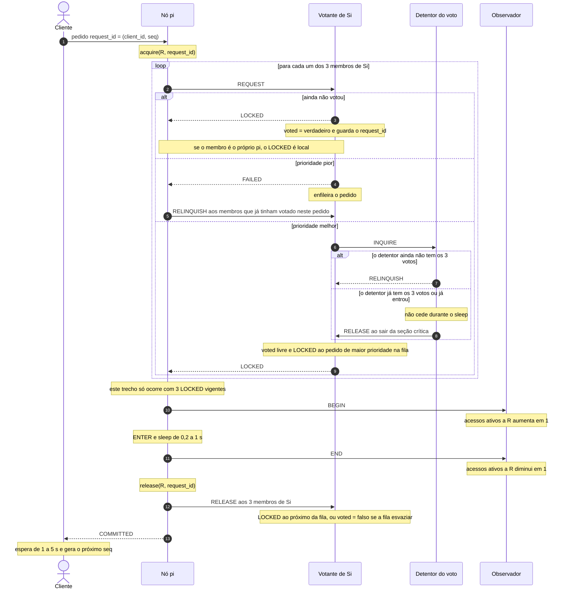
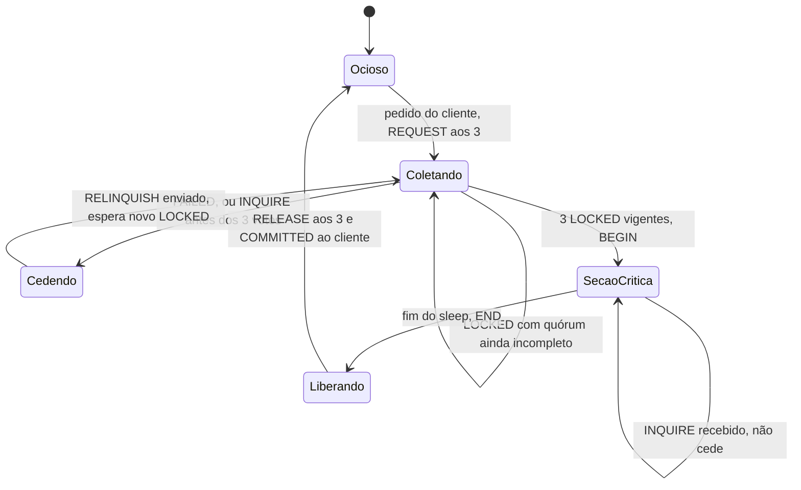
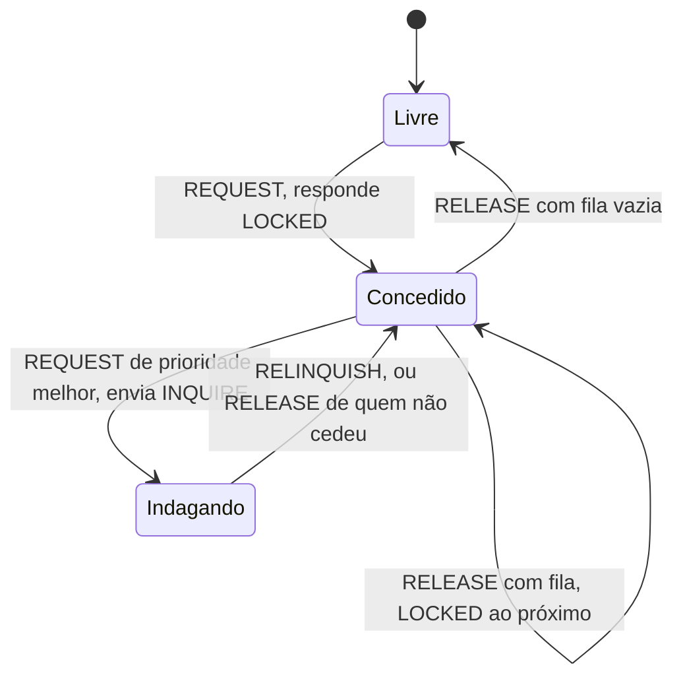
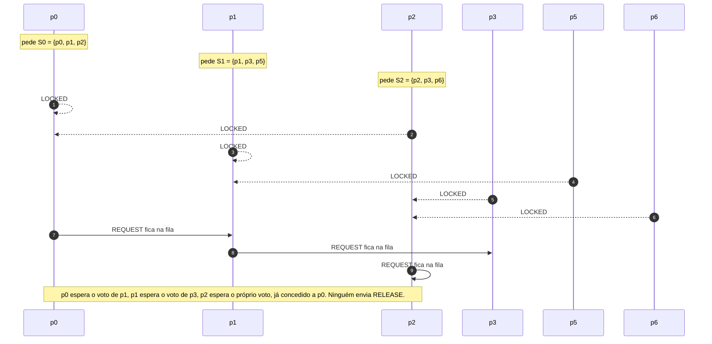

# Diagrama do processo — Maekawa (A6)

Para ver as figuras renderizadas, abra [diagrama-processo.html](diagrama-processo.html) no navegador.

Cada nó do Cluster Sync é, ao mesmo tempo, pedinte do próprio cliente e votante dos conjuntos de que faz parte. A prioridade de um pedido é o menor par `(relógio de Lamport, id do processo)`. Um votante concede no máximo um voto por vez. O observador só conta acessos ativos a R.

Os experimentos usam a variante com FAILED, INQUIRE e RELINQUISH. A versão básica, mais abaixo, é só a evidência de deadlock.

## Acesso a R

O cliente fala apenas com o seu nó. Esse nó pede LOCKED aos 3 membros de Si, inclusive a si mesmo. Com os 3 votos vigentes, entra na seção crítica e só então responde COMMITTED.

Sem disputa são 9 mensagens de protocolo por entrada: 3 REQUEST, 3 LOCKED e 3 RELEASE. BEGIN e END são instrumentação e não entram nessa conta. Se a contagem do observador passa de 1, ele registra a sobreposição e não bloqueia ninguém.

Exemplo de quórum: p0 pede `{p0, p1, p2}`. Uma disputa com p2, que pede `{p2, p3, p6}`, se cruza em p2.

## Estados de quem pede

## Estados de quem vota

Na versão básica o votante não tem o estado Indagando. REQUEST com voto já concedido só enfileira. É isso que permite a espera circular abaixo.

## Deadlock da versão básica

Mensagens apenas REQUEST, LOCKED e RELEASE, sem preempção. Três pedidos bastam para ninguém completar o quórum. Não há falha nem perda de mensagem.

| Quem pede | Conjunto | Votos que já tem | Espera |
|---|---|---|---|
| p0 | {p0, p1, p2} | p0 e p2 | p1, que votou no pedido de p1 |
| p1 | {p1, p3, p5} | p1 e p5 | p3, que votou no pedido de p2 |
| p2 | {p2, p3, p6} | p3 e p6 | p2, que votou no pedido de p0 |

O gerador segura esses votos até o ciclo aparecer e encerra no timeout de 15 s. O log fica com `voted = verdadeiro` nos votantes e com o quórum incompleto em p0, p1 e p2. A carga oficial não usa esta versão.
